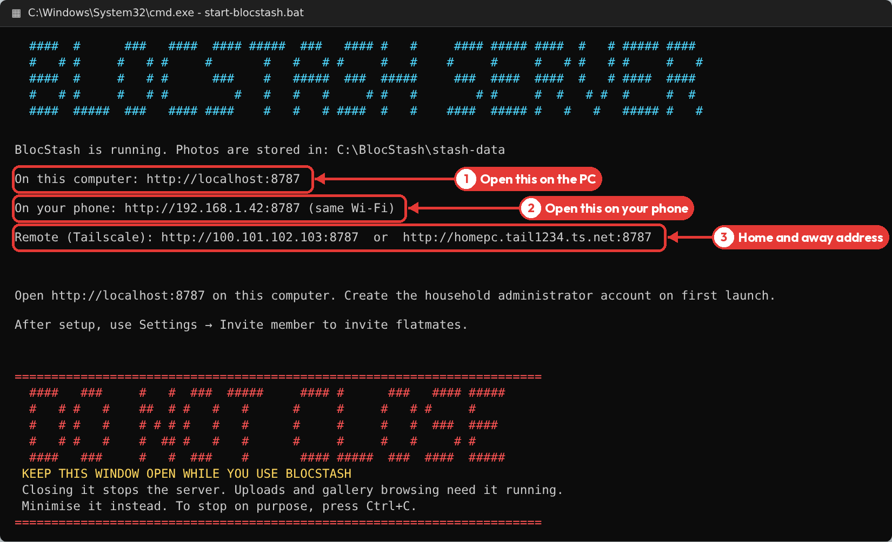
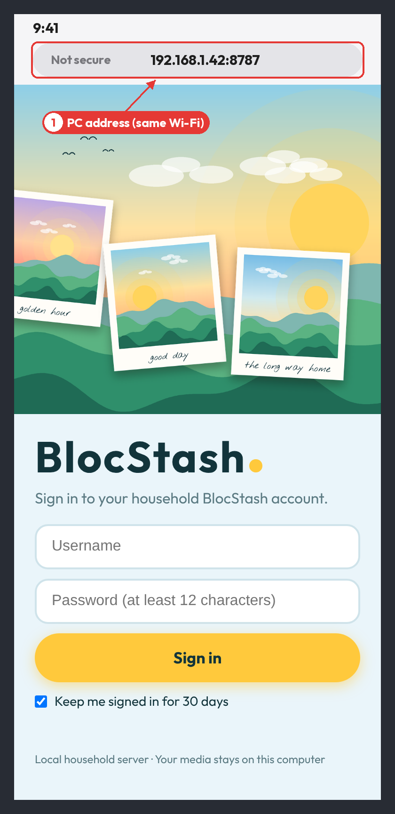
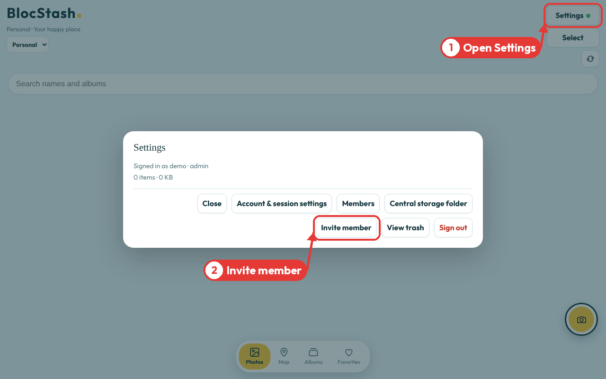
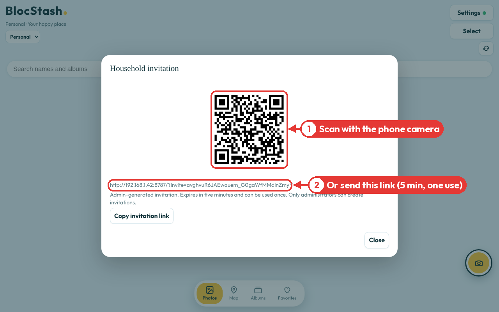
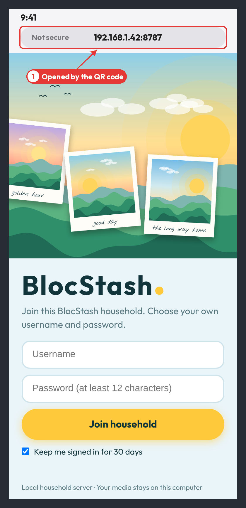

# BlocStash Household Edition

BlocStash is a local-first household photo and video library. Your Windows PC runs the server and stores the original media. Phones and other computers connect over your home Wi-Fi. No cloud account or Firebase hosting is required for core use.

## Quick start (Windows)

You need a Windows PC to act as the server, and phones or other computers on the **same home Wi-Fi**.

> The addresses in the screenshots (such as `192.168.1.42`) are examples. Yours will be different — always use the address your own server prints.

### 1. Start the server

1. Install [Node.js](https://nodejs.org/) 18 or newer. (Optional but recommended: install Python 3 so the invitation QR code can be drawn. Without it you can still share the invitation link.)
2. Extract this project to a permanent folder, for example `C:\Users\<you>\BlocStash`.
3. Double-click **`start-blocstash.bat`**. A terminal window opens and prints two addresses:



- **(1) `On this computer`** – open this address in a browser on the PC.
- **(2) `On your phone`** – the PC's address on your home network. Phones and other computers use this one.

Keep the terminal window open while you use BlocStash. Closing it stops the server.

> **Windows Firewall:** the first time you start the server, Windows asks whether to allow Node.js. Tick **Private networks** and choose **Allow access**. If you missed the prompt, open *Windows Security → Firewall & network protection → Allow an app through firewall* and enable **Node.js JavaScript Runtime** for **Private**.
>
> **Can't see the phone address?** Open a Command Prompt and run `ipconfig`. Your PC's *IPv4 Address* (for example `192.168.1.42`) followed by `:8787` is the phone address.

On macOS or Linux, run `./start-blocstash.sh` instead.

### 2. Create the administrator account (first launch only)

On the PC, open the **`http://localhost:8787`** address (1 above). The first time, BlocStash asks you to create the household administrator account.


1. Enter a username and a unique password of **at least 12 characters**.
2. Click **Create household**.

You are now signed in as the administrator.

### 3. Connect a phone or another computer

There are two ways to get a device connected. Both need the device to be on the same Wi-Fi as the PC.

**Option A – sign in with an existing account**

Open the phone address from the terminal (`http://<PC-LAN-IP>:8787`) in the phone's browser and sign in.



**Option B – invite a new member (flatmate, partner, your own second phone)**

Only the administrator can invite people, and registration is invite-only.

1. **Open BlocStash on the PC using the phone address** (`http://192.168.x.x:8787`), *not* `localhost`. The invitation QR code and link are built from the address you are browsing with, so an invitation created from `localhost` will not work on a phone.
2. Click **Settings** (top right), then **Invite member**.



3. A QR code and a link appear. Scan the QR code with the phone camera, or send the link to the person.



4. The phone opens the join page. The new member chooses their own username and a password of at least 12 characters, then taps **Join household**.



Invitations expire after **five minutes** and work **once**. If it has expired, just create a new one.

### Troubleshooting

- **The phone can't open the address:** check that both devices are on the same Wi-Fi, that the firewall allows Node.js on *Private networks*, and that the terminal window is still open. Guest Wi-Fi or "client/AP isolation" on the router stops devices from seeing each other.
- **The QR code doesn't appear:** Python 3 isn't installed or isn't on the PATH. Use the copyable invitation link instead, or install Python 3.
- **"Invitation invalid or expired":** create a new invitation (step 3 of Option B).
- **The address changes after a reboot:** routers can hand out a new address. Check the terminal for the current one, or reserve a fixed address for the PC in your router settings.
- **Browser says "Not secure":** expected. The home-network server uses plain HTTP, so only use it on a trusted private Wi-Fi (see *Local network and security* below).

## Libraries and permissions

- **Personal:** each member can view and manage their own private library. The household administrator cannot read another member's private library.
- **Shared:** everyone can view the household collection. Members can modify and delete their own contributions. The administrator can manage all shared content.
- **Trash:** deleted items are recoverable for 30 days. The trash view follows the same privacy boundary: members see their own deleted items; the administrator can manage shared-library trash but not private-library trash.
- **Sessions:** each browser gets an individual server-side session. Signing out revokes that session.

The library selector in the app switches between Personal and Shared without signing out.

## Data location

By default, BlocStash stores data in `./stash-data` next to the server:

```text
stash-data/
  files/             Original photos, videos and thumbnails
  trash/             Recoverable deleted media (30 days)
  household.json     Accounts, sessions, library indexes and trash metadata
  .token             Legacy compatibility token; household APIs use account sessions
  index.json         Legacy index retained after migration as a safety copy
```

Set `STASH_DIR` to move storage to another disk. For example, edit `start-blocstash.bat` to set it before starting Node:

```bat
@echo off
cd /d "%~dp0"
set STASH_DIR=D:\BlocStashData
node server\stash-server.js
pause
```

## Existing BlocStash data migration

On first administrator setup, if `stash-data/index.json` exists and contains a valid `items` array, BlocStash imports its entries into the administrator's Personal library. Existing media files are left in place. The old `index.json` is retained as a recovery copy; it is not deleted. Make a complete backup of the old `stash-data` folder before upgrading.

If the legacy index is invalid, setup refuses to overwrite it. Repair or restore the index from backup before retrying.

## Backups and recovery

Stop the server before copying the entire `stash-data` directory. This keeps `household.json`, media files and trash in a consistent backup. Do not back up only `household.json` or only `files/`.

Trash is automatically purged after 30 days. Keep independent backups if you need longer-term recovery.

## Local network and security

- The default local server uses HTTP. Traffic is not encrypted on the LAN; use a trusted private Wi-Fi network.
- Do not expose port 8787 directly to the public internet.
- Passwords are stored as salted scrypt hashes. Session tokens are random and only their SHA-256 hashes are stored on the server. The browser receives an HttpOnly, SameSite=Strict session cookie.
- Core app, login, upload and browsing work locally. The map and EXIF helper currently use external libraries/tiles and may need internet access.
- Household metadata is currently stored in an atomic JSON database (`household.json`) to keep this build dependency-free. SQLite migration is a later hardening step; do not treat this first household build as a substitute for independent backups.

## Central household media folder

After signing in as the household administrator on the Windows PC, choose **Storage** in the toolbar or Settings → Central storage folder. The Windows server opens a native folder picker. Select the drive/folder that should hold the household's originals, thumbnails, and recoverable trash.

The server copies existing media and trash into the selected folder before switching. The previous folder is retained as a backup. The selected path is stored in `stash-data/household.json`; all household uploads from the PC and phones are written by the server into that same folder. Personal and shared libraries remain separated by account metadata and permissions.

Only the administrator can change the central folder. Members cannot select a different destination. If the selected drive is disconnected or not writable, uploads and media access fail with a storage error; BlocStash does not silently fall back to another folder. The Windows folder picker requires the server to be running in an interactive Windows desktop session.

## Invite-only household and QR invitations

- Registration is invite-only after the first administrator account is created. There is no public signup route.
- Only the administrator can create household invitations. Member accounts receive a `403` when attempting to create invitations.
- Invitations are one-use and expire after five minutes.
- The administrator's **Settings** menu has **Invite member**. It displays a real QR code and a copyable invite URL.
- QR images are generated locally by a bundled pure-Python QR generator; no third-party CDN is required. Python 3 must be available (`py -3` or `python` on Windows; `python3` on Linux/macOS). If Python is unavailable, the copyable invite URL remains available.
- The QR code encodes the invite URL using the local server's host address. The invited phone must be on the same Wi-Fi/LAN.
- The QR image endpoint requires an authenticated administrator and checks that the invitation is still valid.

## Login, settings and local folders

- Household login keeps users signed in for 30 days by default. On the login screen, uncheck **Keep me signed in for 30 days** to use a shorter one-day session.
- Once logged in, the top-right **Settings** button is visible. It includes account/session duration, member list, invitations (admin), trash and sign out. Session duration can be changed to 30, 90 or 365 days.
- The **Storage** button is shown only to the household administrator. It selects the server-owned central media folder. The login page no longer offers browser-local folder mode, so selecting a folder cannot bypass household authentication.
- Passkey/biometric login is not yet enabled. WebAuthn needs a trusted secure origin for browser and phone support; the current LAN server uses plain HTTP. HTTPS/certificate setup is a prerequisite for the next authentication stage.

## Household media folder layout

New household uploads retain their original filenames on disk and are stored under `users/<username>/<year>/<month>/`. Capture date metadata is used when available; otherwise the file's last-modified date is used. Thumbnail files are stored alongside their original media with an internal dot-prefixed name. If the same account uploads two files with the same name on the same date, BlocStash adds a short unique suffix to the later stored copy; the filename shown in the library remains unchanged.

Duplicate detection compares filenames only (case-insensitive). It does not read or hash the contents of selected or existing media, so it is substantially quicker, but two different files with the same filename are treated as potential duplicates.
